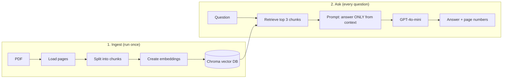

# RAG Chatbot 📄🤖

A simple **Retrieval-Augmented Generation (RAG)** chatbot that answers questions about a PDF document.
It finds the most relevant parts of the PDF and uses an LLM to answer **only from those parts**, with page references.

Tested with a research paper as the demo document.

---

## How it works



1. **Load** – reads the PDF page by page
2. **Split** – cuts the text into 500-character chunks with 50-character overlap, so sentences at the edges aren't lost
3. **Embed** – turns each chunk into a vector (a list of numbers that captures its meaning) with OpenAI `text-embedding-3-small`
4. **Store** – saves the vectors in a local **Chroma** database
5. **Retrieve** – turns the question into a vector and finds the 3 most similar chunks
6. **Generate** – sends the question + those chunks to **GPT-4o-mini**, which is told to answer only from the given context and say *"I don't know"* otherwise

---

## Tech stack

| Purpose | Tool |
|---|---|
| Language | Python 3.12 |
| RAG framework | LangChain |
| PDF loading | PyPDFLoader (pypdf) |
| Embeddings | OpenAI `text-embedding-3-small` |
| Vector database | Chroma |
| LLM | OpenAI `gpt-4o-mini` |
| Package manager | uv |
| Environment | Ubuntu (WSL2), VS Code |

---

## Project structure

```
Basic_RAG_Chatbot/
├── src/
│   └── rag/
│       ├── config.py         # all settings: models, chunk size, paths
│       ├── loader.py         # load the PDF
│       ├── splitter.py       # split text into chunks
│       ├── embeddings.py     # embedding model
│       ├── vector_store.py   # save to / load from Chroma
│       ├── retriever.py      # find the most relevant chunks
│       ├── prompts.py        # instructions for the LLM
│       ├── llm.py            # chat model
│       └── rag_chain.py      # question → retrieve → answer
├── tests/
│   ├── testing.py            # ✏️ builds the vector DB from the PDF
│   └── ask.py                # ✏️ ask questions in the terminal
├── data/                     # your PDFs (not uploaded to GitHub)
├── pyproject.toml
└── uv.lock
```

Each file has **one job**, so a single part (for example the LLM or the vector database) can be swapped without touching the rest.

---

## Getting started

**1. Clone the repo**
```bash
git clone git@github.com:tharunch1402/Basic-RAG-Chatbot.git
cd Basic-RAG-Chatbot
```

**2. Install dependencies** (requires [uv](https://docs.astral.sh/uv/))
```bash
uv sync
```

**3. Add your OpenAI API key**

Create a file named `.env` in the project folder:
```
OPENAI_API_KEY=your-key-here
```

**4. Add a PDF**
```bash
mkdir -p data
cp /path/to/your-file.pdf data/sample.pdf
```

**5. Build the vector database** (run once per PDF)
```bash
uv run python tests/testing.py      # ✏️ check this is your ingest file
```

**6. Ask questions**
```bash
uv run python tests/ask.py
```

### Example
```
Question: ✏️ What problem does this paper try to solve?

Answer: ✏️ paste a real answer from your demo here

Sources: pages [1, 2]
```

---

## Configuration

All settings live in `src/rag/config.py`:

| Setting | Value | Meaning |
|---|---|---|
| `EMBEDDING_MODEL` | `text-embedding-3-small` | Model that creates the vectors |
| `LLM_MODEL` | `gpt-4o-mini` | Model that writes the answer |
| `CHUNK_SIZE` | 500 | Characters per chunk |
| `CHUNK_OVERLAP` | 50 | Characters shared between neighbouring chunks |
| `TOP_K` | 3 | Chunks sent to the LLM per question |

---

## Roadmap

- [x] Basic RAG pipeline (load → chunk → embed → store → retrieve → answer)
- [x] Modular `src/` package structure
- [ ] Load all PDFs in a folder, with error handling and logging
- [ ] FastAPI endpoint
- [ ] Streamlit web interface
- [ ] Unit tests (pytest) and RAG evaluation
- [ ] Docker + docker-compose
- [ ] CI/CD with GitHub Actions
- [ ] Cloud deployment

---

## What I learned

- How RAG grounds an LLM in a document to reduce made-up answers
- Why chunk size and overlap matter for retrieval quality
- How embeddings and vector similarity search work
- Structuring a Python project as a package, with config and secrets kept separate
- Git workflow with SSH, and managing dependencies with uv
